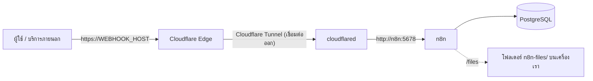

# n8n Student Selfhost — Docker + Cloudflare Tunnel

ชุดติดตั้ง n8n สำหรับนักเรียน รันบนเครื่องตัวเองด้วย Docker ทุก OS (Windows / macOS / Linux)
โดย **ไม่ต้องเปิด port หรือมี public IP** เพราะ webhook เข้ามาผ่าน **Cloudflare Tunnel**
การตั้งค่าทั้งหมด (token, hostname, รหัสผ่าน) อยู่ในไฟล์ `.env` ไฟล์เดียว

## ภาพรวมระบบ



| Service | หน้าที่ |
|---|---|
| `n8n` | ตัว automation engine ที่เราใช้สร้าง workflow |
| `postgres` | ฐานข้อมูลเก็บ workflows / credentials / ประวัติการรัน (ตามแนวปฏิบัติของ n8n สำหรับงานจริง) |
| `cloudflared` | ตัวเชื่อม Cloudflare Tunnel — เปิดสายออกไปหา Cloudflare เท่านั้น ไม่เปิด port เข้าเครื่อง |

> เข้าหน้า editor ได้ 2 ทาง: ผ่าน `https://<WEBHOOK_HOST>` จากที่ใดก็ได้ และผ่าน
> `http://localhost:5678` เมื่อใช้เครื่องตัวเอง (เป็นทางสำรองเวลาเน็ต/tunnel มีปัญหา)

---

## สิ่งที่ต้องเตรียม

1. **Docker** — เลือกตาม OS ของคุณ
   - Windows / macOS: [Docker Desktop](https://www.docker.com/products/docker-desktop/)
   - Linux: Docker Engine + Docker Compose plugin (ติดตั้งตาม [เอกสาร Docker](https://docs.docker.com/engine/install/))
2. **บัญชี Cloudflare (ฟรี)** — สมัครที่ [dash.cloudflare.com](https://dash.cloudflare.com)
3. **โดเมน 1 อัน ที่จัดการ DNS ผ่าน Cloudflare แล้ว** (เช่นได้จากอาจารย์หรือซื้อเอง
   แล้วเพิ่มเข้า Cloudflare) — tunnel ต้องใช้ hostname ใต้โดเมนนี้ เช่น `n8n.ชื่อคุณ.com`

---

## ขั้นตอนติดตั้ง

### ขั้นที่ 1 — สร้าง Cloudflare Tunnel และคัดลอก Token

1. เข้า [Cloudflare Zero Trust](https://one.dash.cloudflare.com) (one.dash.cloudflare.com)
2. เมนูซ้าย: **Networks → Tunnels** → ปุ่ม **Create a tunnel**
3. เลือก **Cloudflared** ตั้งชื่อ tunnel เช่น `n8n-student` → **Create tunnel**
4. หน้า "Install and run a connector" เลือก environment เป็น **Docker**
5. จะเห็นคำสั่งตรง ๆ:
   ```
   cloudflared tunnel --no-autoupdate run --token eyJhIjoi....ยาวมาก
   ```
   ก้อปปี้**เฉพาะค่า token** (ข้อความยาวเริ่มด้วย `eyJ...`) เก็บไว้ก่อน — ใช้ในขั้นที่ 3

### ขั้นที่ 2 — ผูก Public Hostname

ยังอยู่หน้าตั้งค่า tunnel เดิม (หรือมาทีหลังผ่าน Networks → Tunnels → tunnel ของคุณ → **Public Hostname**):

1. กด **Add a public hostname**
2. ตั้งค่า:
   - **Subdomain**: เช่น `n8n`
   - **Domain**: โดเมนของคุณ (เช่น `example.com`) → รวมเป็น `n8n.example.com`
   - **Service Type**: `HTTP`
   - **URL**: `n8n:5678`  ← สำคัญ! ต้องเป็นชื่อ service ใน docker network พอดี ๆ
     (ห้ามใช้ `localhost` เพราะ cloudflared อยู่คนละ container กับ n8n)
3. กด **Save hostname**

จำ hostname นี้ไว้ (`n8n.example.com`) — ต้องใช้ตรงกันในขั้นที่ 3

### ขั้นที่ 3 — เตรียมไฟล์ `.env`

จากโฟลเดอร์โปรเจกต์ คัดลอกไฟล์ตั้งค่า:

```bash
# macOS / Linux (หรือ Git Bash บน Windows)
cp .env.example .env
```
```powershell
# Windows PowerShell
Copy-Item .env.example .env
```
```bat
:: Windows Command Prompt
copy .env.example .env
```

แล้วเปิด `.env` ด้วย editor ใดก็ได้ กรอกให้ครบ 4 ค่านี้:

| ตัวแปร | ใส่อะไร |
|---|---|
| `TUNNEL_TOKEN` | token จากขั้นที่ 1 (ยาว ๆ เริ่มด้วย `eyJ`) |
| `WEBHOOK_HOST` | hostname จากขั้นที่ 2 เช่น `n8n.example.com` — **ไม่มี** `https://` นำหน้า |
| `N8N_ENCRYPTION_KEY` | สร้างเองด้วยคำสั่งด้านล่าง |
| `POSTGRES_PASSWORD` และ `POSTGRES_NON_ROOT_PASSWORD` | รหัสผ่านที่คุณตั้งเอง (จำไว้ ไม่ต้องจำก็ได้ อยู่ในไฟล์นี้แล้ว) |

สร้าง `N8N_ENCRYPTION_KEY` (กุญแจเข้ารหัส credentials — ทำครั้งเดียว อย่าเปลี่ยนภายหลัง):

```bash
# macOS / Linux / Git Bash บน Windows
openssl rand -base64 48
```
```powershell
# Windows PowerShell
[Convert]::ToBase64String((1..48 | ForEach-Object { Get-Random -Maximum 256 }))
```

ก้อปปี้ผลลัพธ์ทั้งบรรทัดไปวางใน `.env` เช่น `N8N_ENCRYPTION_KEY=Xy3kQ...==`

> ⚠️ กุญแจนี้สำคัญมาก — ถ้าหายหรือเปลี่ยน credentials ที่บันทึกไว้จะเปิดไม่ได้เลย
> เก็บสำเนา `.env` ไว้ในที่ปลอดภัย (เช่น password manager)

### ขั้นที่ 4 — รันระบบ

```bash
docker compose up -d
```

ตรวจสอบสถานะ (ต้องเห็น `n8n`, `postgres`, `cloudflared` ขึ้น `healthy` / `running`):

```bash
docker compose ps
```

ดู log ถ้ามีปัญหา:

```bash
docker compose logs -f n8n
docker compose logs -f cloudflared
```

### ขั้นที่ 5 — เข้าใช้งานครั้งแรก

เปิดเบราว์เซอร์ไปที่ `https://<WEBHOOK_HOST>` เช่น `https://n8n.example.com`
(หรือทางสำรอง http://localhost:5678 เมื่ออยู่ที่เครื่องตัวเอง) แล้วกรอกฟอร์ม
**Set up owner account** — อีเมล + รหัสผ่านนี้คือบัญชีผู้ดูแลของ n8n ที่คุณจะใช้ login

### ขั้นที่ 6 — ทดสอบ Webhook

1. สร้าง workflow ใหม่ → เพิ่ม node **Webhook** (HTTP Method: `GET`)
2. ดูช่อง **Production URL** — ต้องเป็น `https://<WEBHOOK_HOST>/webhook/<path>`
   ถ้ายังเป็น `localhost` แปลว่า `WEBHOOK_HOST` ใน `.env` ไม่ถูก ให้แก้แล้วรัน
   `docker compose up -d --force-recreate n8n`
3. กด **Execute workflow** (โหมดทดสอบ) แล้วยิง request:
   ```bash
   curl "https://<WEBHOOK_HOST>/webhook-test/<path>"
   ```
4. เมื่อ **Activate** workflow แล้ว จะใช้ Production URL:
   `https://<WEBHOOK_HOST>/webhook/<path>`

---

## คำสั่งที่ใช้บ่อย

| คำสั่ง | ความหมาย |
|---|---|
| `docker compose up -d` | เริ่มระบบทั้งหมด (แบบพื้นหลัง) |
| `docker compose ps` | ดูสถานะ container |
| `docker compose logs -f n8n` | ดู log แบบเรียลไทม์ |
| `docker compose stop` | หยุดชั่วคราว (ข้อมูลไม่หาย) |
| `docker compose start` | เริ่มใหม่จากที่หยุด |
| `docker compose down` | หยุดและลบ container (ข้อมูลยังอยู่ใน volume) |
| `docker compose down -v` | ⚠️ ลบ container **และข้อมูลทั้งหมด** — ใช้เมื่อต้องการเริ่มใหม่จริง ๆ |

---

## การอัปเดตเวอร์ชัน n8n

เราตั้งค่าเวอร์ชันไว้ใน `.env` (ตัวแปร `N8N_VERSION`) เพื่อให้ทุกเครื่องใช้เวอร์ชันเดียวกัน
และป้องกันการอัปเดตอัตโนมัติที่อาจพัง workflow เดิม

1. **สำรองข้อมูลก่อนเสมอ** (ดูหัวข้อถัดไป)
2. ดูเวอร์ชันล่าสุดและ release notes ที่ [n8n releases](https://github.com/n8n-io/n8n/releases)
   แล้วแก้ `N8N_VERSION` ใน `.env` (เช่น `2.50.0`)
3. อัปเดต:
   ```bash
   docker compose pull
   docker compose up -d
   ```
4. ลบ image เก่า (ถ้าต้องการคืนพื้นที่): `docker image prune -f`

> เวลาอัปเกรดเวอร์ชันใหญ่ (เช่น 2.x → 3.x) อ่าน release notes ก่อนเสมอ เพราะอาจมี
> breaking changes ที่กระทบ workflow เดิม

---

## การสำรองข้อมูล / ย้ายเครื่อง

ข้อมูลถาวรอยู่ใน **2 volumes** (ชื่อขึ้นต้น `n8n-student-selfhost_` ดูได้จาก `docker volume ls`):

- `n8n-student-selfhost_n8n_data` — encryption keys, settings, ประวัติ binary data
- `n8n-student-selfhost_postgres_data` — workflows, credentials, ประวัติการรัน

**สำรอง (backup):**

```bash
# macOS / Linux / Git Bash — รันจากโฟลเดอร์โปรเจกต์
docker run --rm -v n8n-student-selfhost_n8n_data:/data -v "$(pwd)":/backup alpine tar czf /backup/n8n_data.tgz -C /data .
docker run --rm -v n8n-student-selfhost_postgres_data:/data -v "$(pwd)":/backup alpine tar czf /backup/postgres_data.tgz -C /data .
```
```powershell
# Windows PowerShell — รันจากโฟลเดอร์โปรเจกต์
docker run --rm -v n8n-student-selfhost_n8n_data:/data -v "${PWD}:/backup" alpine tar czf /backup/n8n_data.tgz -C /data .
docker run --rm -v n8n-student-selfhost_postgres_data:/data -v "${PWD}:/backup" alpine tar czf /backup/postgres_data.tgz -C /data .
```

จะได้ไฟล์ `n8n_data.tgz` และ `postgres_data.tgz` ในโฟลเดอร์โปรเจกต์

**กู้คืน (restore) บนเครื่องใหม่:**

1. ติดตั้ง Docker + โคลน repo นี้ + วางไฟล์ `.env` เดิม (จำเป็น! ต้องเป็น encryption key ตัวเดิม)
2. แตกไฟล์กลับเข้า volume:
   ```bash
   docker volume create n8n-student-selfhost_n8n_data
   docker run --rm -v n8n-student-selfhost_n8n_data:/data -v "$(pwd)":/backup alpine sh -c "tar xzf /backup/n8n_data.tgz -C /data"
   ```
   (ทำแบบเดียวกันกับ `postgres_data`)
3. รัน `docker compose up -d`

> ง่ายสุด: เก็บชุด `[.env, n8n_data.tgz, postgres_data.tgz]` ไว้ก็ย้ายเครื่องได้ทุก OS

---

## แก้ปัญหาที่เจอบ่อย

| อาการ | สาเหตุ / วิธีแก้ |
|---|---|
| เปิด `https://<hostname>` ได้แต่ขึ้น **502 Bad Gateway** | Public Hostname ใน Cloudflare ต้องตั้ง Service เป็น `HTTP` → URL `n8n:5678` (ตามขั้นที่ 2) |
| เปิดเว็บไม่ได้เลย (tunnel ไม่ออนไลน์) | ดู log: `docker compose logs cloudflared` — ส่วนใหญ่ token ผิดหรือลืมใส่ แก้ `TUNNEL_TOKEN` ใน `.env` แล้วรัน `docker compose up -d --force-recreate cloudflared` |
| URL ใน Webhook node เป็น `localhost` ไม่ใช่ domain | `WEBHOOK_HOST` ใน `.env` ผิด/ว่าง — แก้แล้วรัน `docker compose up -d --force-recreate n8n` |
| ยิง webhook ผ่าน domain ได้ แต่ `localhost` ไม่ได้ (หรือกลับกัน) | ปกติ — เส้นทางเดียวกันคนละประตู เช็คว่า workflow **Activate** แล้ว (ใช้ `/webhook/` ไม่ใช่ `/webhook-test/`) |
| เข้า `http://localhost:5678` ไม่ได้ | ยังไม่ได้รัน `docker compose up -d` หรือ n8n กำลังเริ่มระบบ (รอ ~30 วินาทีแรก) |
| เวลาใน Schedule Trigger ไม่ตรง | เช็ค `GENERIC_TIMEZONE` ใน `.env` (default `Asia/Bangkok`) แล้วรัน `docker compose up -d --force-recreate n8n` |
| ลืมรหัสผ่านบัญชี owner | รีเซ็ตได้ (workflows ไม่หาย): `docker compose exec n8n n8n user-management:reset` แล้วเข้าเว็บใหม่เพื่อตั้งรหัสผ่านใหม่ |
| compose ขึ้น error เรื่อง `TUNNEL_TOKEN` / `N8N_ENCRYPTION_KEY` / `WEBHOOK_HOST` | ยังไม่ได้กรอกค่าใน `.env` — กลับไปขั้นที่ 3 |

---

## โครงสร้างไฟล์

```
n8n-student-selfhost/
├── docker-compose.yml   # นิยาม 3 services: postgres, n8n, cloudflared
├── .env.example         # แม่แบบตั้งค่า — คัดลอกเป็น .env แล้วกรอกค่า
├── .env                 # ค่าจริงของคุณ (ไฟล์ความลับ ห้าม commit)
├── init-data.sh         # สร้างบัญชี DB ให้ n8n (รันอัตโนมัติครั้งแรก)
├── n8n-files/           # โฟลเดอร์แลกเปลี่ยนไฟล์กับ workflow (n8n เห็นเป็น /files)
└── README.md
```

## ข้อควรรู้ด้านความปลอดภัย

- **`.env` คือกุญแจบ้าน** — มี token ของ tunnel, encryption key และรหัสผ่าน DB อยู่ในนั้น
  ห้าม commit / ห้ามส่งในแชท (repo นี้ตั้ง `.gitignore` กันไว้แล้ว)
- พอร์ต 5678 ผูกกับ `127.0.0.1` เท่านั้น — เครื่องอื่นใน Wi-Fi เดียวกันมองไม่เห็น
  การเข้าถึงจากภายนอกทำได้ผ่าน Cloudflare เท่านั้น
- อยากกันคนอื่นเข้าหน้า editor ให้เพิ่ม Cloudflare Access policy ที่ hostname
  (Zero Trust → Access → Applications — ทำ email OTP ได้ฟรี) และแยก path
  `/webhook*` ให้ไม่โดน Access เพื่อให้บริการภายนอกยิง webhook ได้
- ถ้าจะรับ webhook จากบริการอื่น ควรใช้ Webhook node แบบกำหนด **Header Auth** เพิ่มเสมอ
- n8n ใช้สัญญาอนุญาต [Sustainable Use License](https://docs.n8n.io/sustainable-use-license/)
  — ใช้ภายในองค์กร/การศึกษาได้ฟรี แต่ห้ามนำไปขายต่อเป็นบริการ

## สำหรับผู้สอน

- ให้นักเรียนแต่ละคน (หรือกลุ่ม) ใช้ subdomain ไม่ซ้ำกัน เช่น `n8n-student01.example.com`
- ทุกคนแก้แค่ `.env` ของตัวเอง โครงสร้างโปรเจกต์เหมือนกันทุกเครื่อง ทุก OS
- ปีใหม่ ๆ แนะนำให้ pin `N8N_VERSION` เป็นเวอร์ชันเดียวกันทั้งห้อง เพื่อให้หน้าจอ/ฟีเจอร์ตรงกันตอนสอน
